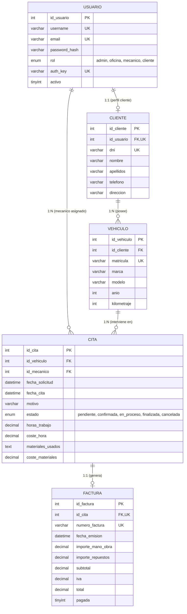

# MotorFix - Sistema de Gestión Integral de Taller Mecánico

**Práctica Evaluable Intermodular | 2º CFGS Desarrollo de Aplicaciones Multiplataforma (DAM)**
* **Centro Docente:** EFA El Campico
* **Profesor:** Víctor Sarabia
* **Módulos:** Acceso a Datos (AD) & Desarrollo de Interfaces (DI)
* **Arquitectura:** MVC Desacoplado + Fetch API (JSON) + PDO Singleton + Autenticación por Token `auth_key`

---

## 1. Modelo Entidad-Relación (E-R) de la Base de Datos

El esquema físico se encuentra en [`sql/motorfix.sql`](sql/motorfix.sql) para MySQL / MariaDB (`utf8mb4`).



---

## 2. Backlog del Proyecto (Jira / Trello / GitHub Projects)

* **Tablero de Trello:** [MotorFix en Trello](https://trello.com/invite/b/6adf9eebe545bdd6b6330c01/ATTIaa1dc2f3f92e2a5164e37ecb5828267f43DDD262/motorfix) ([`res/trello.txt`](res/trello.txt))
* **Diagrama de Clases UML:** [`res/Usuario Cliente Authentication Model-2026-10-26-181112.png`](res/Usuario%20Cliente%20Authentication%20Model-2026-10-26-181112.png)

| Código | Semana / Sprint | Épica | Tarea / Historia de Usuario | Estado |
| :--- | :--- | :--- | :--- | :--- |
| **MF-01** | Semana 1 (19-25 Oct) | Infraestructura | Configurar repositorio Git (`motorfix`) y estructura MVC desacoplada | Completado |
| **MF-02** | Semana 1 (19-25 Oct) | Base de Datos | Diseñar modelo E-R y script `sql/motorfix.sql` con datos semilla | Completado |
| **MF-03** | Semana 1 (19-25 Oct) | Backend (AD) | Implementar clase `Conexion.php` con patrón PDO Singleton y lectura de `.env` | Completado |
| **MF-04** | Semana 2 (26 Oct-01 Nov) | Backend (AD) | Implementar modelos POO `Usuario.php` (con BCrypt y `auth_key`), `Cliente.php` y `Vehiculo.php` | Pendiente |
| **MF-05** | Semana 2 (26 Oct-01 Nov) | Frontend (DI) | Maquetar vistas HTML5/CSS3 responsivas (`index.html`, `cliente.html`) | Pendiente |
| **MF-06** | Semana 3 (02-08 Nov) | Backend (AD) | Implementar modelos POO `Cita.php` y `Factura.php` | Pendiente |
| **MF-07** | Semana 3 (02-08 Nov) | Servicios Web | Desarrollar `auth_sw.php` y conectar Login/Registro con `fetch()` y `auth_key` | Pendiente |
| **MF-08** | Semana 4 (09-15 Nov) | Cliente (DI/AD) | Desarrollar `cliente_sw.php`, `vehiculo_sw.php`, `cita_sw.php` y panel `cliente.js` | Pendiente |
| **MF-09** | Semana 5 (16-22 Nov) | Taller y Facturas | Desarrollar `oficina.html`, `mecano.html`, `admin.html`, `taller.js` y `factura_sw.php` | Pendiente |
| **MF-10** | Semana 6 (23-30 Nov) | QA y Entrega | Pruebas de integración, revisión de seguridad, memoria final y exportación de Jira | Pendiente |

---

## 3. Configuración del Entorno (Semana 1)

1. Importar el script [`sql/motorfix.sql`](sql/motorfix.sql) en el contenedor MySQL/MariaDB (`db:3306`).
2. Verificar las credenciales en [`backend/.env`](backend/.env):
   ```ini
   DB_HOST=
   DB_NAME=
   DB_USER=
   DB_PASS=
   DB_PORT=
   ```
3. Usuarios de prueba incluidos en el seed (contraseña para todos: `password`):
   * **Admin:** `admin@motorfix.es`
   * **Oficina:** `oficina@motorfix.es`
   * **Mecánico:** `carlos@motorfix.es`
   * **Cliente:** `laura@cliente.es` / `pedro@cliente.es`
